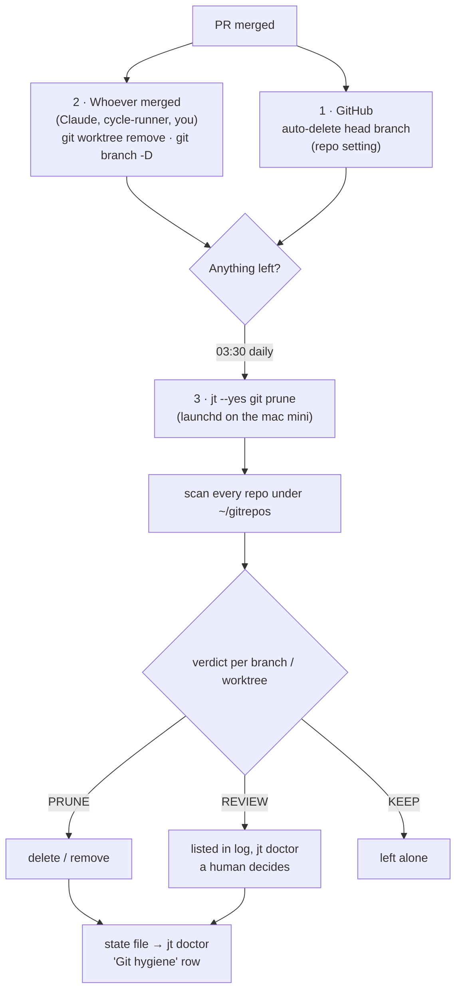
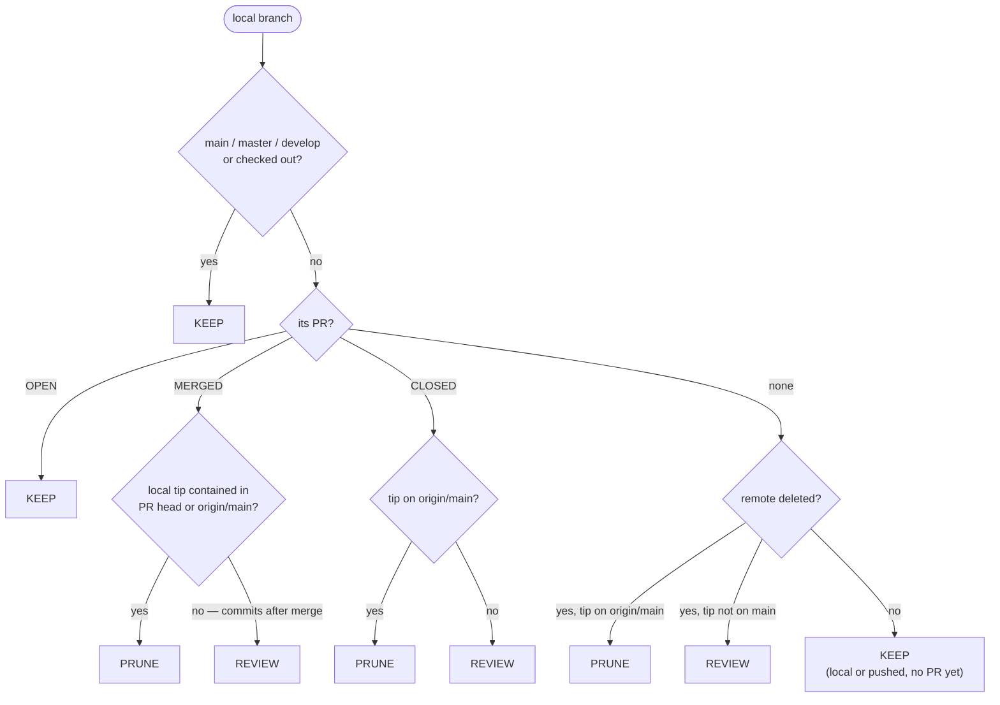

# Git hygiene — `jt git`

Merged feature branches and finished worktrees pile up fast on a machine where
agents open a branch (and often a worktree) per ticket. On the mac mini in
November 2026 one repo had 206 local branches, 184 of them for merged PRs, and
nine abandoned worktrees. `jt git` keeps that at zero without ever risking work.

## The three layers

Cleanup happens in three places, from most to least immediate. Each one catches
what the one before it missed.



1. **GitHub** deletes the remote branch on merge (`delete_branch_on_merge`, or
   `gh pr merge --delete-branch`).
2. **Whoever merged** removes their own worktree and local branch immediately —
   the rule in `~/.claude/CLAUDE.md` ("Clean up the moment a PR merges"). For
   ticket worktrees under `~/.local/state/cycle-runner/worktrees` that is
   `linear.sh worktree-done SB-N`, which the cycle-runner calls after its own
   merge (same refusal rules, same artefact list).
3. **`jt git prune`** sweeps whatever slipped through, nightly.

## How a verdict is reached



Worktrees are decided first, because a branch checked out in a worktree cannot
be deleted until the worktree is gone:

| Worktree | Verdict |
|---|---|
| directory already deleted | PRUNE (stale record; `git worktree prune`) |
| your current directory, a `protected_paths` entry, or `locked` | KEEP |
| detached HEAD (a tool's checkout, e.g. a backup mirror) | KEEP |
| uncommitted changes other than build artefacts | REVIEW |
| branch's PR merged, nothing committed after | PRUNE (`--force` only if the untracked files are all artefacts) |
| PR open / no PR | KEEP |
| PR closed unmerged, or commits after merge | REVIEW |

**Build artefacts** (`git.artifacts`) are untracked names that are rebuilt on
demand — `.venv`, `node_modules`, caches, `html-report`. A worktree whose only
untracked files are these is clean. A *tracked* file under such a name is still
work.

One quirk errs on the safe side: when a whole directory is untracked, git
reports only the directory (`?? newdir/`), not the `.venv` inside it, so that
worktree is REVIEW rather than PRUNE. In practice artefacts sit beside tracked
files (`backend/.venv` in a tracked `backend/`) and are recognised.

### Safety rules

- **A repo whose scan had any error is not pruned at all** — failed `git fetch`,
  or GitHub (`gh`) unreachable. Without fresh PR data "merged" can't be trusted.
- PR state comes from GitHub, not from `git branch --merged`: squash merges never
  look merged to git.
- "Nothing committed after merge" is checked with `git merge-base --is-ancestor`
  against the PR's head commit **and** `origin/<default>`.
- Dry runs (`--dry-run`) are never recorded as a run.

## Commands

```bash
jt git audit                  # read-only report for every repo under git.roots
jt git audit --repo .         # the repo you're in (also from inside a worktree)
jt git audit --all            # include KEEP items and their reasons
jt git prune                  # confirm, then prune (PRUNE items only)
jt --yes git prune            # no prompt — what the schedule runs
jt --dry-run git prune        # show what would go
jt git schedule install       # daily LaunchAgent (macOS); re-run after config changes
jt git schedule status        # loaded? last run's counts
jt git schedule uninstall
jt doctor                     # "Git hygiene" row: last run age, counts, review items
```

Exit code is 1 when anything failed or a repo was skipped, so the scheduled log
and `jt doctor` both show it.

## When Claude (or any agent) runs what

| Moment | Command |
|---|---|
| Right after merging its own PR | `git worktree remove <path>` + `git branch -D <branch>` (direct — no `jt` needed) |
| Before ending a session / `/handoff` | `jt git audit --repo .` — report leftovers; prune only its own |
| Disk warning, or `jt doctor` shows Git hygiene ⚠ | `jt git audit`, then `jt git prune` |
| User asks to clean up branches/worktrees | `jt --dry-run git prune`, show it, then `jt --yes git prune` |
| REVIEW items | never delete them — list them for the user |

`jt git prune` is safe for an agent to run unattended **because** it only acts
on PRUNE verdicts. Anything else is a question for a human.

## Where things live

| What | Where |
|---|---|
| Config | `~/.config/janitor/config.toml`, `[git]` |
| LaunchAgent | `~/Library/LaunchAgents/com.silverbeer.janitor.git-prune.plist` |
| Log of scheduled runs | `~/Library/Logs/janitor/git-prune.log` |
| Last run (for doctor) | `~/.janitor/state/git-prune.json` |
